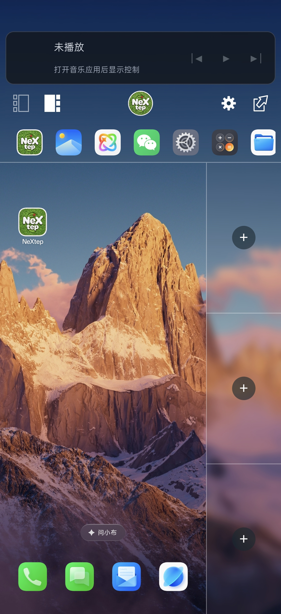
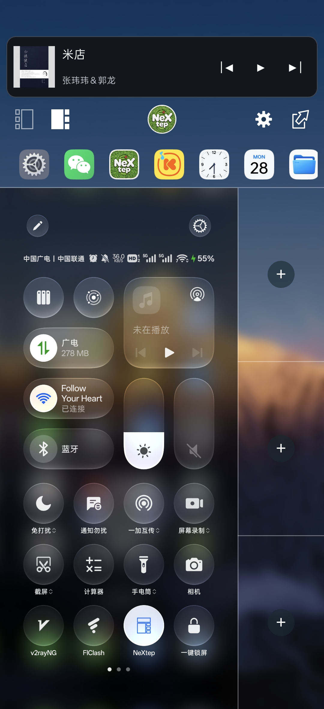
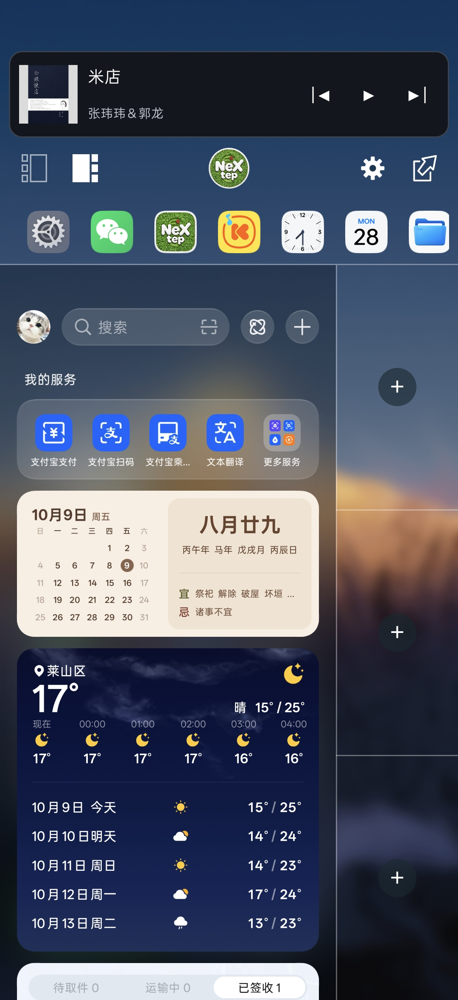
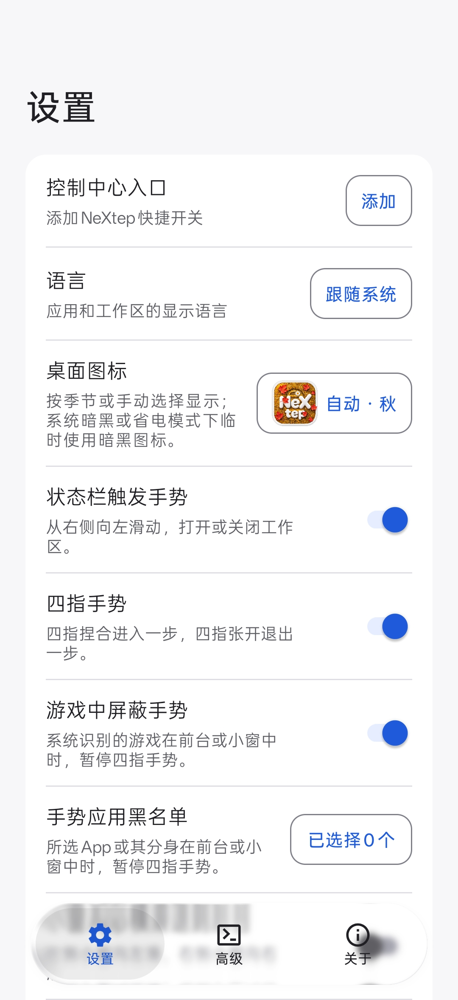
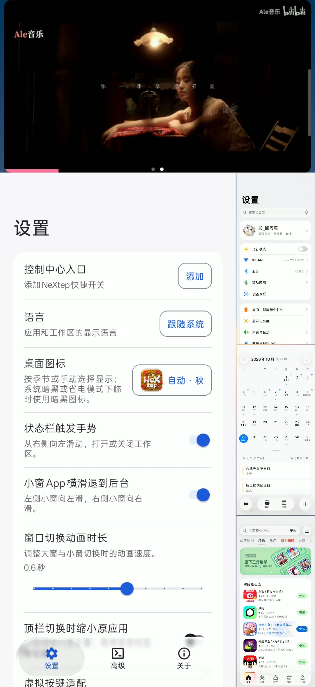

<p align="center">
  
</p>

<h2 align="center">NeXtep — A Tribute to and Continuation of OneStep</h2>

<p align="center">
  <a href="README.md">English</a> / <a href="README_CN.md">中文</a>
</p>

<p align="center">
  
  
  
  
  
  
  
</p>

<p align="center">
  &nbsp;
  &nbsp;
  &nbsp;
  &nbsp;
  
</p>

# NeXtep

**NeXtep** is an **LSPosed module** that adds a **native side workspace** to ColorOS 16 / 17 while keeping the **stock launcher**. It provides **one main window and three live task slots**, with task switching, drag-and-drop, media controls, and customizable app shortcuts integrated into SystemUI.

The project primarily targets **OnePlus PLK110**, previously verified on **Android 16 / ColorOS 16**. Recent feature and compatibility testing is based on **Android 17 / ColorOS 17**. It relies on private Android and ColorOS behavior, so **other devices, ROM versions, and vendor launchers require adaptation**.

**Beta channel: 2.1.1 beta1.** The stable source is maintained on [main](https://github.com/lujinxin/NeXtep/tree/main); published APKs are available from GitHub Releases.

[Download and release notes](https://github.com/lujinxin/NeXtep/releases) · [Demo video on Bilibili](https://www.bilibili.com/video/BV1iKHj6fEtL)

[Features](#features) · [Energy monitoring](#energy-monitoring-and-resource-use) · [Requirements](#requirements) · [Installation](#installation) · [Workspace controls](#open-and-close-the-workspace) · [External commands](#external-commands) · [Behavior switches](#behavior-switches)

## Features

### Workspace and layout

- **Stock launcher:** keeps the ColorOS launcher without registering a replacement HOME app, with adaptations for launcher shortcut menus, desktop search, and the assistant panel.
- **One main window and three live slots:** keep several app tasks visible together and move whole tasks between the main window and slots.
- **Left and right layouts:** switch the slot sidebar using the layout buttons in the control area.
- **Portrait and both landscape orientations:** keep the control area and three slots in their layout relative to the phone while the main app follows system rotation. The embedded video can follow the screen direction independently, without moving the control area or rebuilding the slot layout.
- **Navigation-button adaptation:** optionally fit the main window and slots around the system navigation bar. Enable it for three-button navigation and disable it for gesture navigation; after changing the system navigation mode, toggle the option again.
- **Task retention:** restore eligible slot tasks that remain in the system when closing and reopening the workspace. Locking pauses slot output; unlocking restores the workspace with its tasks.
- **System integration:** coexists with native floating windows above the workspace panels, and includes adaptations for keyboard focus, notification shade and Control Center interaction, brightness controls, and video-window sizing.

### Task management

| Action | How to use it |
|--------|---------------|
| Put the main app in a slot | With a regular app in the main window, tap the **+** in an empty slot. |
| Add from Recents | Center the desired task card in system Recents, then tap an empty slot's **+**. Recents stays open so you can add more apps. Exit split screen before adding a grouped split-screen card. |
| Exchange a slot with the main window | Tap an occupied slot, or long-press it and drag it onto the main window. |
| Move or exchange slots | Long-press an occupied slot and drag it onto an empty slot to move, or another occupied slot to exchange. Drop targets are highlighted during dragging. |
| Open an app in the main window | Tap its icon in the app strip. |
| Add from the app strip | Long-press an app icon and drag it onto the target slot. |
| Move a slot app to the background | Swipe outward: left for left-side slots, right for right-side slots. No long press is needed. This gesture can be disabled in Settings. |
| Move to the background by dragging | Long-press a slot and drag it onto the control area; release when **Release to move to background** appears. This remains available when swipe dismissal is disabled. |

Moving a slot app to the background frees the slot while retaining its task and leaving the main window unchanged. Opening an app from the launcher when it already occupies a slot exchanges it with the main window.

The optional **Park the previous main app when switching** setting moves the previous main app into an empty slot when switching from the app strip. If no empty slot is available, the app switch proceeds normally. It is disabled by default.

### App strip and cloned apps

- **Automatic ordering:** arrange app shortcuts by recent usage; this is the default mode.
- **Manual ordering:** choose up to **36 apps**, remove shortcuts, and long-press selected entries to reorder them.
- **System app clones:** show cloned apps in the app strip and manual selection list, with clone labels to distinguish them from the original apps.

### Gestures and app exclusions

- **Four-finger gesture:** pinch four fingers together to enter the workspace and spread them apart to exit. It is enabled by default and can be switched independently of the status-bar gesture.
- **Game exclusion:** enabled by default. Four-finger gestures are suspended when a system-recognized game is in the foreground or any workspace slot.
- **App blacklist:** select apps by icon and name, with a checkbox on the right. Four-finger gestures are suspended while a selected app or its system clone is in the foreground or a slot. The list is empty by default.

These exclusions apply to the four-finger gesture. Other workspace entry points remain available.

### Media controls

- Display track artwork, title, and artist information from the active system media session, with **previous**, **play/pause**, and **next** controls as supported by the playback app.
- Tap the artwork, title, or another area outside the playback buttons to open the playback app in the main window. If it occupies a slot, it exchanges with the main window.
- Use a soft gradient drawn from the track artwork, retaining the colors while paused. With no media session or usable artwork, the card falls back to frosted wallpaper.

### Control-area video

The control area has a **Video** page alongside **Controls**. Supported floating video windows are detected and displayed automatically, with playback remaining in the source app. The supported sources are system picture-in-picture (PiP) and eligible app-provided floating video windows; OEM freeform windows and secure/protected video are not generally supported.

1. Start playback in the source app and enable system PiP or the app's own floating video window.
2. Open the workspace. A supported floating window automatically moves into the **Video** page.
3. Swipe left or right across the control area to switch between **Controls** and **Video**. If the window remains outside, use the video shortcut on **Controls** or tap **Show video here** on **Video**.

Tap the embedded video to show compact glass controls. They hide automatically after a short delay.

| Control | Behavior |
|---------|----------|
| Play / pause | Use the source app's media session or an available native player control. Availability depends on the player. |
| Show full picture / Fill area | Default to uniform scaling with the complete picture centered in both axes. Choose fill explicitly to crop the edges and cover the area. |
| Return to floating window | Restore the original native window. The return shortcut on **Controls** provides the same action. |
| Close | Request the source player's own close action when available. |

- **Independent orientation:** the control area stays in place while the picture follows the current system display direction. With the phone held sideways, the control region appears tall: a portrait picture can use that space, while a landscape picture remains upright and gets space above and below when needed. System rotation lock is respected.
- **Retained embedding:** a rotation keeps the same valid native window embedded, rather than returning it to a floating window and capturing it again. Rotation also keeps the selected full-picture/fill mode.
- **Frosted surrounding area:** unused space shows the panel's wallpaper and frost effect. Black bars already drawn by the source player remain part of its picture; they are not detected or removed automatically.

Locking the device or closing the workspace restores the native window. A manually returned window stays outside after unlocking until it is captured again.

### Energy monitoring and resource use

Open **Advanced → Runtime and diagnostics → Energy monitor** to view live readings and copy a report.

| Readings | Included information |
|----------|----------------------|
| Device battery | Battery level, temperature and temperature change, charge state, voltage, current, estimated net battery power, average discharge power from unplugged samples, thermal status, and power-saving mode. |
| Workspace runtime | Workspace state, retained slot displays, aggregate slot frame updates, module task queries and preview captures, and overall SystemUI host CPU usage. |

Sampling runs every **5 seconds** while this page is visible and the device is unlocked. Leaving the page or locking the device stops sampling. Unsupported readings appear as **—**.

Battery readings describe the whole device; charging power is not the device's total consumption. CPU usage covers the entire shared SystemUI process, with 100% representing one CPU core. These readings cannot isolate NeXtep's own battery consumption.

The workspace reduces idle task polling, combines pending refreshes, and avoids redundant preview captures. Retained slot displays request **60 Hz** independently of the physical screen's refresh rate. Slot output and task polling are suspended while locked, and the retained workspace resumes after unlocking.

### Appearance and text

The control area and slot backgrounds use the wallpaper, including adaptations for ColorOS live wallpaper. Frosting leaves app content sharp.

| Setting | Options and behavior |
|---------|----------------------|
| Top content | NeXtep icon, time, date and weekday, blank, or custom text. The default is the icon; mode changes take effect immediately. |
| Clock seconds | Optional, disabled by default; the switch appears beside the time option. |
| Custom text | The editor appears in custom-text mode. Drafts are remembered when switching modes; tap **Save text** to apply edits. |
| Looping text | Disabled by default. Enable continuous scrolling for both short and long text; otherwise text is centered and overflow is ellipsized. Scrolling pauses while the workspace is hidden. |
| Font | Search, preview, and select fonts installed on the device, or choose a generic font family. System default follows the device's font setting. |
| Text size and weight | **10–28 sp**, default **16 sp**, with optional bold styling and an input preview. |
| Frost strength | **0–100**, default **50**. Release the slider to save and apply the value to the control area and slot backgrounds. |
| Launcher icon | Choose default, spring, summer, autumn, winter, or dark artwork, or switch automatically with the season. System dark mode or power-saving mode temporarily uses the dark icon. Icon changes preserve its launcher position. |

### Settings, languages, and updates

- **Settings / Advanced / About:** use bottom navigation to switch between workspace settings, runtime diagnostics and external-control commands, and project information. The settings interface follows the system's light or dark theme and uses a liquid-glass bottom navigation bar.
- **Advanced page groups:** separate **Runtime and diagnostics** from **Shell commands**, with energy monitoring, command prerequisites, copy buttons, and setup instructions in their respective sections.
- **Languages:** follow the system or select **Simplified Chinese, Traditional Chinese, English, Japanese, or Korean** for the app and workspace.
- **Settings shortcut:** tap the control area's gear button to open NeXtep settings while keeping workspace mode active.
- **About:** view the installed version, check for updates, open release and source pages, and read license information and acknowledgements.
- **Update download:** view available release notes and open the APK download in a browser. Downloaded updates are installed manually.

## Requirements

- **OnePlus PLK110**: previously verified on **Android 16 / API 36, ColorOS 16**; recent partial device testing uses **Android 17 / API 37, ColorOS 17**. The APK minimum is API 35, which does not imply compatibility with every device on that API level.
- A matching **ColorOS 16 / 17** build on an adapted device.
- **KernelSU** or another compatible root solution.
- **Zygisk and LSPosed** with modern libxposed API support.
- Enable the module for all applicable packages in the bundled [scope list](app/src/main/resources/META-INF/xposed/scope.list), including SystemUI, system framework, launcher, app-clone service, and assistant panel.

This module modifies **SystemUI, Launcher, and system-server behavior**. **Keep a working recovery path**, and disable the module if the device enters a boot loop or core UI becomes unstable.

Testing has not covered every app or edge case. Other devices and ROMs require separate adaptation; untested configurations have no compatibility guarantee.

## Installation

1. Download the APK from [GitHub Releases](https://github.com/lujinxin/NeXtep/releases), or build it using [docs/BUILDING.md](docs/BUILDING.md).
2. Install it on the target device.
3. Enable NeXtep in LSPosed for all applicable packages in the bundled scope list.
4. Reboot the device.
5. Open NeXtep's **Settings** page to configure the workspace and add its Control Center tile.

## Open and close the workspace

After enabling the module and rebooting, unlock the device. Use any of these entry points:

- **Status-bar gesture:** swipe horizontally to the left from the top-right status-bar area. Swiping down still opens the system notification shade or Control Center. The gesture is enabled by default and can be disabled independently.
- **Four-finger gesture:** pinch to enter and spread to exit. The independent switch, game exclusion, and app blacklist are on the **Settings** page.
- **Control Center tile:** in NeXtep's Settings, tap **Add** in the **Control Center entry** row and confirm. Pull down Control Center and tap **NeXtep** to toggle the workspace. If adding it from the app fails, use Control Center's edit screen.
- **External commands:** copy commands from the **Advanced** page into a gesture, shortcut, automation, or terminal tool; see below.
- **Exit button:** tap the exit button in the workspace control area to return to fullscreen.

### External commands

The **Advanced** page provides copy buttons for entering, exiting, and querying workspace mode. The module must be enabled and the device rebooted; run entry and exit commands with **Root privileges while the phone is unlocked**.

Enter the workspace:

```sh
am broadcast -n io.github.lujinxin.nextep/.trigger.WorkspaceControlBrokerReceiver -a io.github.lujinxin.nextep.action.HOST_SET_REQUEST --ez io.github.lujinxin.nextep.extra.REQUESTED_ACTIVE true
```

Exit the workspace:

```sh
am broadcast -n io.github.lujinxin.nextep/.trigger.WorkspaceControlBrokerReceiver -a io.github.lujinxin.nextep.action.HOST_SET_REQUEST --ez io.github.lujinxin.nextep.extra.REQUESTED_ACTIVE false
```

Query the current state:

```sh
settings get global nextep_workspace_active_v1
```

The state is `1` while the workspace layout is active and `0` when inactive. Lock-screen suspension also publishes an inactive state; query after unlocking when using it in an automation.

## Behavior switches

These switches are on the **Settings** page; appearance and app ordering are described in the feature sections above.

| Setting | Default | Behavior |
|---------|---------|----------|
| Status-bar gesture | On | Enable or disable the top-right horizontal gesture. The Control Center tile remains available. |
| Four-finger gesture | On | Pinch four fingers together to enter and spread them apart to exit. |
| Block gestures in games | On | Suspend four-finger gestures when a recognized game is in the foreground or a slot. App blacklist exclusions can be configured separately. |
| Swipe slot apps to the background | On | Enable or disable outward swipe dismissal. Dragging a slot to the control area remains available. |
| Park the previous main app when switching | Off | Move the previous main app into an empty slot when switching from the app strip; switch normally if none is available. |
| Navigation-button adaptation | Off | Enable for three-button navigation and disable for gesture navigation. Toggle again after changing the system navigation mode. |

## Architecture

The diagram shows how the regular APK coordinates with the LSPosed-injected SystemUI, stock launcher, assistant panel, app-clone service, and system_server. It separates main-window presentation from the three live slots and shows configuration reads, change notifications, and shared runtime state. Compatibility hooks are guarded individually and skip unavailable targets.

[Architecture details](docs/ARCHITECTURE.md) · [Interactive diagram (download HTML to view)](docs/architecture/nextep-architecture.html) · [Diagram source](docs/architecture/nextep-architecture.json)

<p align="center">
  <a href="assets/nextep-architecture.png">
    
  </a>
</p>

## Feedback group

QQ group: **1128561895**

<p align="center">
  
</p>

## Acknowledgements

Special thanks to **Smartisan OS OneStep** for the product concept and interaction inspiration behind this project.

## License and attribution

NeXtep is licensed under the [Apache License 2.0](LICENSE). See [THIRD_PARTY_NOTICES.md](THIRD_PARTY_NOTICES.md) for third-party attribution and design provenance.

Copyright 2026 lujinxin.
