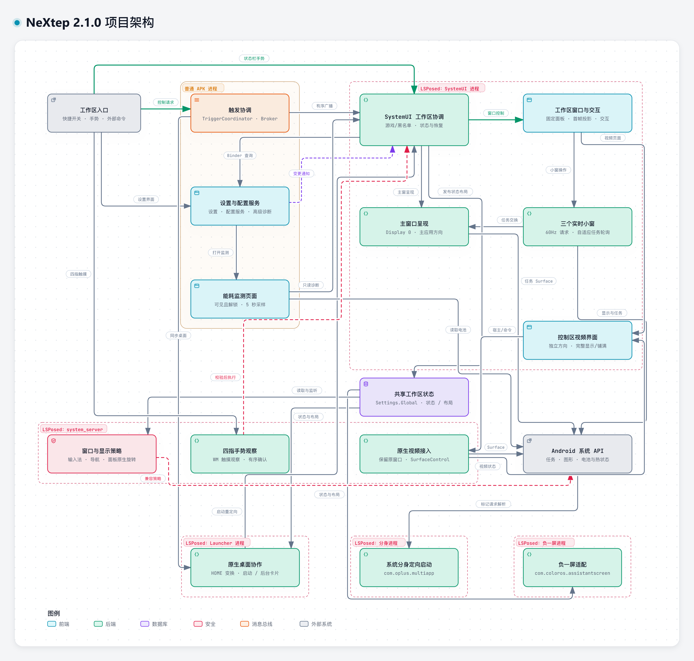

# NeXtep Architecture

NeXtep keeps the stock ColorOS launcher and adds a SystemUI-owned workspace with one main region and three live task slots.

The diagram maps the process boundaries and responsibilities of the **2.1.0 implementation**. Explore the standalone [HTML viewer](architecture/nextep-architecture.html) or edit the [JSON source](architecture/nextep-architecture.json). Source references point to commit `5397e625e485819b77613d4c6a2001610c676185`.

## Process ownership

| Process | Responsibilities |
|---------|------------------|
| Ordinary NeXtep APK | Settings, Advanced, About and energy-monitor pages; update checks; Quick Settings tile; trigger coordination and broker; persisted settings and permission-protected configuration services. |
| `com.android.systemui` | Workspace state and recovery; four-finger policy checks; fixed control and slot panels; media sessions; input and drag handling; main-task presentation; three VirtualDisplay slots; video host surface; privileged app catalogue and read-only runtime diagnostics. |
| Resolved ColorOS HOME package | Launcher transforms and inverse input mapping; app-start redirection; desktop shortcut menus; reading the selected Recents card on supported launcher implementations. |
| `com.coloros.assistantscreen` | Separate assistant-panel window transforms, input mapping and restoration based on workspace state. It remains a separate process from HOME. |
| `com.oplus.multiapp` | Handles NeXtep-marked clone launches through the OEM resolver, preserving the requested Android user. Unmarked requests keep the OEM chooser behavior. |
| `system_server` | Four-finger touch observation; native video-window docking and restoration; window/display policy adaptations for keyboard targets, navigation bars, task surfaces, native floating layers, orientation and panel rotation. |

[`NeXtepHookEntry`](../app/src/main/kotlin/io/github/lujinxin/nextep/xposed/NeXtepHookEntry.kt) installs hooks by host package or the system-server lifecycle callback. Each feature is guarded; a failed hook returns control to the original host behavior where possible. The ordinary APK does not acquire SystemUI privileges.

## Workspace control

Quick Settings calls [`TriggerCoordinator`](../app/src/main/kotlin/io/github/lujinxin/nextep/trigger/TriggerCoordinator.kt). External commands target [`WorkspaceControlBrokerReceiver`](../app/src/main/kotlin/io/github/lujinxin/nextep/trigger/WorkspaceControlBrokerReceiver.kt), which enters the same coordinator.

The coordinator resolves the current HOME package and uses explicit ordered broadcasts to query or set state. A toggle checks Launcher and SystemUI readiness and protocol compatibility, updates SystemUI first, then synchronizes HOME. If the HOME update fails during a toggle, it attempts to restore the previous SystemUI state. Explicit set requests return the actual HOME result after applying the SystemUI request; their failure handling is not identical to toggle rollback.

The status-bar gesture is observed inside SystemUI and can drive the local workspace controller directly. Exit/recovery paths also notify HOME and the assistant panel, with the broker available for reconciliation. The control area's exit button and gear button are distinct: exit closes the workspace; the gear opens NeXtep through task coordination while retaining workspace mode.

Control broadcasts use `io.github.lujinxin.nextep.permission.CONTROL_WORKSPACE`, a signature permission. The exported broker is protected by `android.permission.STATUS_BAR_SERVICE`. Host-to-host paths authenticate the expected package or immutable `PendingIntent` identity; these are separate checks rather than one generic broadcast trust rule.

### Four-finger gestures

[`FourFingerGestureHook`](../app/src/main/kotlin/io/github/lujinxin/nextep/systemserver/FourFingerGestureHook.kt) observes the default display's WM pointer stream in system_server without replacing the original dispatcher. The recognizer proposes entry or exit through an explicit ordered broadcast to SystemUI.

[`FourFingerGestureController`](../app/src/main/kotlin/io/github/lujinxin/nextep/systemui/FourFingerGestureController.kt) owns acceptance: it checks request age, the independent gesture switch, lock/display readiness, current workspace state, and game or blacklist exclusions among the foreground and visible slot tasks. SystemUI acknowledges acceptance before scheduling the state change and rechecks the policy when applying it. Only an accepted request can cancel the still-current contact stream; rejected gestures leave application input intact.

## Configuration, language and app catalogue

[`SettingsRepository`](../app/src/main/kotlin/io/github/lujinxin/nextep/config/SettingsRepository.kt) persists behavior switches, top content, typography, blur strength and app ordering in the APK process. App language uses Android's persisted application locales. Changes notify SystemUI, whose background executor refreshes configuration without blocking its main thread.

[`WorkspaceConfigClient`](../app/src/main/kotlin/io/github/lujinxin/nextep/config/WorkspaceConfigContract.kt) reads configuration in this order:

1. Call `WorkspaceConfigProvider` through Binder.
2. If that produces no valid configuration, reuse the last verified local snapshot in SystemUI's device-protected storage.
3. If no snapshot is available, query `WorkspaceConfigReceiver` with an explicit ordered broadcast.

The provider checks the caller's UID or `STATUS_BAR_SERVICE` permission; the receiver is protected by that permission in the manifest. Runtime state, app-strip configuration and the selected language are applied to the appropriate views without modifying host application resources.

The ordinary settings APK cannot enumerate every user's apps. [`LauncherAppCatalogContract`](../app/src/main/kotlin/io/github/lujinxin/nextep/apps/LauncherAppCatalogContract.kt) queries the privileged catalogue in SystemUI for clone/profile metadata, then reconstructs entries in the settings process. App-catalogue replies carry metadata rather than full-size icons.

## Shared runtime state and geometry

[`SystemServerWorkspaceBridge`](../app/src/main/kotlin/io/github/lujinxin/nextep/workspace/SystemServerWorkspaceBridge.kt) publishes workspace activity and geometry through `Settings.Global`, separately from APK configuration. The shared values include active state, sidebar side, screen dimensions, navigation insets, rotation and recorded layout profiles.

SystemUI owns publication. Launcher and the assistant panel use this state to align or restore their surfaces; system-server policy hooks consume the relevant active geometry. A `ContentObserver` keeps a local system-server snapshot so hot window callbacks can use memory rather than repeatedly querying SettingsProvider.

[`WorkspaceViewport`](../app/src/main/kotlin/io/github/lujinxin/nextep/systemui/WorkspaceViewport.kt) and [`WorkspaceLayoutProfile`](../app/src/main/kotlin/io/github/lujinxin/nextep/workspace/WorkspaceLayoutProfile.kt) derive and record the shared layout. Both landscape directions, left/right slot placement and the optional three-button navigation adaptation use that model. After changing the system navigation mode, the user toggles navigation-button adaptation again.

Pure rotation projects the existing panels into display coordinates while retaining their logical layout, slot buffers and wallpaper frame. [`WorkspacePanelHost`](../app/src/main/kotlin/io/github/lujinxin/nextep/systemui/WorkspacePanelHost.kt) stages the window configuration before drawing, and `WorkspacePanelProjection` retains the previous valid frame while dimensions and rotation disagree. `WorkspacePanelRotationHook` applies native seamless handling only to NeXtep's named SystemUI panels. Main-app presentation and the embedded video's canvas follow their own orientation paths.

## Main window and three task slots

These are separate presentation responsibilities inside SystemUI.

[`MainTaskPresentationCoordinator`](../app/src/main/kotlin/io/github/lujinxin/nextep/task/MainTaskPresentationCoordinator.kt) handles foreground tasks on Display 0. HOME remains owned by launcher transforms. An ordinary fullscreen app uses `SurfaceTaskPresenter` and task-leash transforms, with bounds overrides cleared where required. Native freeform, PiP and split-screen surfaces keep their WM Shell ownership. Main-task transforms are restored before migration or workspace exit.

[`NeXtepWindowController`](../app/src/main/kotlin/io/github/lujinxin/nextep/systemui/NeXtepWindowController.kt) owns workspace windows, the viewport, visual transitions and slot coordination. `TopAppStripView` includes media, layout/settings/exit controls and app shortcuts. `MediaControlView` follows the active media session and dispatches playback controls; opening its playback app uses the same main/slot task coordination.

[`SlotTaskCoordinator`](../app/src/main/kotlin/io/github/lujinxin/nextep/display/SlotTaskCoordinator.kt) serializes task movement and exchanges. Each [`VirtualDisplaySlot`](../app/src/main/kotlin/io/github/lujinxin/nextep/display/VirtualDisplaySlot.kt) owns a `TextureView → Surface → VirtualDisplay` lifecycle. Slot resolution and density come from the current layout profile; they are not fixed device-specific constants.

Supported input paths include:

- Tapping an empty slot to park the regular foreground app.
- Querying the centered Recents card through an authenticated Launcher contract, then adding it while keeping Recents open.
- Tapping an occupied slot to exchange it with the main task.
- Dragging an app shortcut into a slot, or moving/exchanging an occupied slot with another slot or the main window.
- Swiping a slot outward or dropping it on the control area to move its app to the background.
- Optionally parking the previous main app in a genuinely empty slot when switching from the app strip.

Failed moves retain recovery information. On workspace exit, tasks must leave their slot displays before those displays are released. Eligible tasks can be retained for a later workspace session while they remain available in the system.

### Control-area video ownership

[`ControlAreaVideoView`](../app/src/main/kotlin/io/github/lujinxin/nextep/systemui/ControlAreaVideoView.kt) owns the video page and an ephemeral SurfaceControl host in SystemUI. [`ControlAreaVideoContract`](../app/src/main/kotlin/io/github/lujinxin/nextep/workspace/ControlAreaVideoContract.kt) carries the session, surface capability, dimensions, fit/fill mode and commands to system_server, with host permission and creator-identity checks. These handles are never persisted in shared settings.

[`ControlAreaVideoController`](../app/src/main/kotlin/io/github/lujinxin/nextep/systemserver/ControlAreaVideoController.kt) borrows a supported non-secure native PiP or app video window, reparents its surface through a dock, and applies the shared `ControlAreaVideoGeometry`. Playback and audio remain in the source app. The picture is uniformly scaled and centered; fill mode crops to the viewport. The display-aligned video canvas remains independent of the phone-aligned panel, and transparent unused space reveals its frosted wallpaper.

An already embedded, valid source stays docked through a rotation transition; only acquisition of a new source waits for transition completion. Locking, exit, source or host invalidation, and an explicit return restore the native parent. The SystemUI host waits for a restoration acknowledgement before releasing the borrowed ancestor. It retries a failed restoration and retains the isolated ancestor if restoration remains unconfirmed. Source-player black bars are not detected or removed.

## Energy diagnostics and runtime cost

[`EnergyMonitorActivity`](../app/src/main/kotlin/io/github/lujinxin/nextep/config/EnergyMonitorActivity.kt) runs in the ordinary APK. It samples only while visible, resumed and physically unlocked, at five-second intervals, and stops on page exit or screen lock. `BatterySample` reads whole-device battery and thermal APIs on its worker; [`WorkspaceEnergyContract`](../app/src/main/kotlin/io/github/lujinxin/nextep/monitoring/WorkspaceEnergyContract.kt) separately queries a signature-protected, read-only SystemUI snapshot. No continuously sampling monitor service is involved.

SystemUI supplies workspace state, retained-display and frame counts, task-query and preview-capture counters, and shared-host CPU time. Battery power is net power at the battery; CPU covers the whole SystemUI process. Neither measurement isolates NeXtep's own energy use, and charging power is not total device consumption.

Task changes trigger a short fast-recovery interval; idle slot polling falls back to a slower interval. Refresh requests are coalesced, redundant preview work is avoided, and retained virtual displays request 60Hz independently of the physical display's mode. Lock suspension stops slot output and related polling while keeping the workspace recoverable.

## System-server policy adaptations

[`SystemServerHook`](../app/src/main/kotlin/io/github/lujinxin/nextep/systemserver/SystemServerHook.kt) installs independently guarded adaptations for:

- Workspace input-method targets and navigation-bar layout.
- Slot native layout and workspace task surfaces.
- Display hierarchy and native floating-window layers.
- Fixed-orientation aspect ratios and size-compat display insets.
- Both landscape directions.
- Video fullscreen exit during display migration and slot display configuration.
- Native rotation-buffer handling restricted to NeXtep's own SystemUI panels.

Four-finger observation and control-area video docking are separately installed responsibilities in the same process.

These hooks complement SystemUI presentation. They do not move workspace UI ownership into system_server, and the main-window and slot engines still call Android task, surface and display APIs through checked compatibility wrappers.

## Lock, unlock and recovery

`WorkspaceState` includes `Disabled`, `Entering`, `Active`, `Suspended`, `Exiting` and `Faulted`. Transitions run on the host main thread, with cleanup or rollback when an operation cannot complete.

Locking suspends slot output and temporarily restores main-display presentation while retaining tasks. Keyguard and physical-display callbacks, with broadcast/polling fallbacks, coordinate restoration after unlock; the saved layout and last valid wallpaper frame can be reused before a refreshed frame arrives. Stale inactive reconciliation must not undo a newer entry. The published shared active value is `0` while suspended, so external state queries should be interpreted after unlock. Configuration changes can reconfigure the existing workspace rather than always exiting it.

A workspace exit stops related observation and restores owned surfaces. Opening settings preserves the workspace. The module remains a normal APK activated by LSPosed; external Root commands are optional entry points and no separate Root daemon is part of this architecture.
